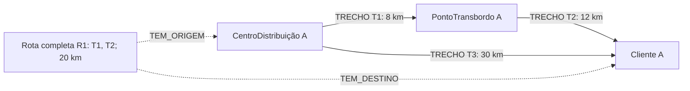

# Modelagem dos dados e dos percursos logísticos

Estudo de caso 04 — modelagem da implementação  
Data: 26 de outubro de 2026

Esta modelagem detalha a divisão dos dados entre MongoDB, Redis e Neo4j. Ela usa as decisões registradas em [PLANEJAMENTO.md](PLANEJAMENTO.md): execução local no Windows 10, dados de demonstração autorizados, custo por distância em quilômetros, alertas simulados e `Rota` como percurso completo. O recebimento será integral, com baixa de estoque no despacho e liberação do veículo no recebimento.

Os exemplos são fictícios e não representam uma empresa, documento fiscal ou trajeto real. Os scripts da implementação seguem esta modelagem; a integração foi validada com MongoDB, Redis e Neo4j reais, conforme [docs/VALIDACAO.md](docs/VALIDACAO.md).

## 1 Identidade e responsabilidade dos dados

| Informação | Banco responsável | Referências nos demais bancos |
| --- | --- | --- |
| Mercadoria e lote | MongoDB | IDs nos manifestos |
| Manifesto, despacho e recebimento | MongoDB | Identificador da operação no Redis e referência à rota |
| Auditoria documental | MongoDB | Referência à entidade ou operação |
| Última telemetria | Redis | Mesmo ID de veículo usado no manifesto |
| Disponibilidade atual do veículo | Redis | Histórico documental permite conferir a situação |
| Locais, trechos e percurso completo | Neo4j | IDs e cópia histórica do percurso no manifesto |

IDs estáveis devem ser compartilhados entre os bancos, por exemplo `DEMO-VEI-001`, `DEMO-LOT-001` e `DEMO-ROT-001`. Todos os dados de carga terão identificação de demonstração. Datas persistidas no MongoDB serão datas BSON; strings ISO 8601 nos exemplos abaixo servem apenas à apresentação em JSON.

`manifesto_id` identifica o documento que acompanha a carga; `operacao_id` identifica uma ação, como um despacho ou uma confirmação de recebimento; `evento_id` identifica uma ocorrência de auditoria ou um alerta. Repetir a mesma ação reutiliza sua identidade, enquanto ações diferentes do mesmo manifesto recebem identidades distintas.

## 2 MongoDB

### Coleções propostas

| Coleção | Campos propostos | Consultas e índices candidatos |
| --- | --- | --- |
| `mercadorias` | `_id`, `descricao`, `especificacoes_tecnicas`, `especificacoes_fiscais`, `demonstracao` | Busca por ID; outros índices conforme os filtros aprovados |
| `lotes` | `_id`, `mercadoria_id`, `quantidade`, `unidade`, `local_id`, `demonstracao` | Índices por `mercadoria_id` e `local_id` |
| `manifestos` | `_id`, `itens`, `veiculo_id`, `origem_id`, `destino_id`, `percurso`, `documentacao_carga`, `despacho`, `recebimento`, `demonstracao` | Índice por veículo e data de despacho; `_id` identifica o manifesto |
| `auditoria` | `_id`, `operacao_id`, `entidade_tipo`, `entidade_id`, `acao`, `ocorrido_em`, `detalhes`, `demonstracao` | Índice por entidade e data; chave de evento idempotente |

Os índices são candidatos ligados às consultas planejadas, não uma lista de comandos já executados. O `_id` de cada documento terá a unicidade padrão do MongoDB. A identidade de cada evento de auditoria deverá impedir a duplicação da mesma ocorrência sem impedir eventos legítimos posteriores.

### Exemplo de mercadoria

```json
{
  "_id": "DEMO-MER-001",
  "descricao": "Mercadoria de demonstração",
  "especificacoes_tecnicas": {},
  "especificacoes_fiscais": {},
  "demonstracao": true
}
```

Os objetos de especificações permanecem flexíveis. Códigos fiscais, tributos, faixas de temperatura e exigências de conservação não foram fornecidos e não serão inventados como regras.

### Exemplo de lote

```json
{
  "_id": "DEMO-LOT-001",
  "mercadoria_id": "DEMO-MER-001",
  "quantidade": 10,
  "unidade": "unidade",
  "local_id": "DEMO-CD-001",
  "demonstracao": true
}
```

Quantidade e unidade são valores ilustrativos. Na proposta, `quantidade` representa o saldo corrente no local de origem indicado por `local_id`. As quantidades expedidas são descontadas ao confirmar o despacho, conforme a regra aprovada. A confirmação do recebimento integral não deve repetir esse desconto.

### Manifesto e histórico

Um manifesto contém seus itens como documentos incorporados, cada um referenciando um lote. A proposta agrupa o percurso confirmado, o despacho e o recebimento no mesmo documento, facilitando manter coerentes os dados centrais dessa operação. Eventos de auditoria ficam separados, evitando crescimento ilimitado de uma lista dentro do manifesto.

O recebimento confirma integralmente os itens e quantidades expedidos nesse manifesto. A proposta mantém um registro de despacho e um de recebimento integral, cada um com identidade própria de operação e horário de confirmação. As repetições da mesma ação não geram um novo débito de estoque ou um novo recebimento.

O campo `percurso` contém `rota_id`, sequência ordenada dos trechos, origem/destino de cada trecho, distância de cada trecho e distância total no momento do despacho. A documentação da carga é JSON livre, conforme confirmado pelo usuário.

A forma de incorporar ou referenciar dados deve seguir as consultas e o crescimento esperado dos documentos. Essa é a base técnica desta proposta, conforme as [orientações de modelagem do MongoDB](https://www.mongodb.com/docs/manual/data-modeling/best-practices/).

## 3 Redis

Prefixo proposto para a demonstração: `sc:demo:`. Ele separa os dados fictícios e evita confundir sua carga com dados operacionais.

| Chave ou canal | Tipo | Conteúdo proposto |
| --- | --- | --- |
| `sc:demo:frota:veiculos` | Set | IDs dos veículos da demonstração |
| `sc:demo:veiculo:{id}:telemetria` | Hash | Latitude, longitude, velocidade em km/h, temperatura em °C, instante medido, instante recebido e marca de demonstração |
| `sc:demo:veiculo:{id}:estado` | Hash | Disponibilidade, manifesto associado, última operação e horário da atualização |
| `sc:demo:manifestos:recebidos` | Set | IDs dos manifestos já recebidos; impede que uma repetição tardia reabra a reserva de um transporte concluído |
| `sc:demo:alertas:desvio` | Canal Pub/Sub | Eventos simulados de desvio de rota |
| `sc:demo:alertas:acidente` | Canal Pub/Sub | Eventos simulados de acidente |

Os canais não são chaves persistidas. Um evento proposto contém `evento_id`, `tipo`, `veiculo_id`, `manifesto_id` quando aplicável, `ocorrido_em` e `demonstracao: true`.

O estado de disponibilidade distingue o veículo disponível daquele em transporte. O despacho confirmado mantém o veículo indisponível; a confirmação do recebimento integral o devolve à disponibilidade, desde que a associação ao manifesto ainda corresponda à operação processada.

### Telemetria e validade

Armazenar o horário da medição permite distinguir leitura atual de leitura antiga. A tela consulta a telemetria a cada 5 segundos e marca leituras com mais de 30 segundos como desatualizadas, conforme confirmado. A última leitura é preservada com seu horário, sem TTL que apague a disponibilidade do veículo.

Ausência de leitura significa informação indisponível, e não velocidade zero ou veículo disponível. Nenhum limite de temperatura ou velocidade foi definido como gatilho de alerta.

### Alertas simulados

Fluxo proposto: controle na interface → serviço Python → `PUBLISH` no Redis → assinante Python no aplicativo → apresentação do evento na torre de controle.

O assinante usará conexão dedicada e terá seu ciclo de vida controlado para evitar duplicação de consumidores a cada atualização da tela. A entrega à interface será compatível com a execução do Streamlit, sem chamar a interface diretamente de uma rotina consumidora em segundo plano.

Redis Pub/Sub entrega mensagens aos assinantes conectados e não oferece histórico para quem estava desconectado. Portanto, não se deve prometer reenvio automático de alertas. O histórico de auditoria proposto no MongoDB pode registrar o evento publicado, mas isso não transforma Pub/Sub em entrega garantida. [Documentação oficial de Pub/Sub](https://redis.io/docs/latest/develop/use-cases/pub-sub/).

## 4 Neo4j

### Nós

Preservar os quatro rótulos do estudo de caso, incluindo o significado de percurso completo confirmado pelo usuário.

| Rótulo | Significado | Propriedades propostas |
| --- | --- | --- |
| `CentroDistribuição` | Local de distribuição | `id`, `nome`, `operante`, `demonstracao` |
| `PontoTransbordo` | Local de transbordo | `id`, `nome`, `operante`, `demonstracao` |
| `Cliente` | Local de entrega ao cliente | `id`, `nome`, `operante`, `demonstracao` |
| `Rota` | Percurso completo entre origem e destino | `id`, `trechos_ids`, `distancia_total_km`, `demonstracao` |

`trechos_ids` é uma lista ordenada dos IDs dos trechos que compõem o percurso. A distância total é derivada deles, e não um valor independente digitado sem conferência.

### Relações

| Relação | Estrutura | Finalidade |
| --- | --- | --- |
| `TRECHO` | Local → Local | Malha física; propriedades `id`, `distancia_km`, `operante`, `demonstracao` |
| `TEM_ORIGEM` | Rota → Local | Identificar a partida do percurso completo |
| `TEM_DESTINO` | Rota → Local | Identificar o término do percurso completo |

Cada local pertence a um dos três rótulos de local exigidos. Os trechos conectam esses locais diretamente. O nó `Rota` descreve o percurso completo e referencia seus trechos pela lista ordenada; não representa um segmento da malha.



As consultas de navegação percorrem exclusivamente `TRECHO`. Incluir `TEM_ORIGEM` ou `TEM_DESTINO` na busca criaria atalhos artificiais por um nó `Rota` e produziria resultados incorretos.

### Integridade proposta

- ID único por nó e por trecho; IDs de locais globalmente distintos entre os três rótulos.
- Distância de cada trecho positiva e expressa em quilômetros.
- Cada rota com uma origem, um destino e uma sequência contínua de trechos.
- O destino de um trecho deve coincidir com a origem do seguinte.
- `TEM_ORIGEM` deve apontar para a origem do primeiro trecho e `TEM_DESTINO` para o destino do último.
- A soma das distâncias deve coincidir com o total da rota.
- A aplicação valida referências e continuidade; listas de IDs não criam integridade referencial automática no Neo4j.
- Alterar ou remover um trecho exige verificar as rotas que o referenciam; lista, distância total e relações de origem/destino devem permanecer coerentes.
- As restrições de unicidade e consultas exatas serão definidas conforme a versão escolhida.

As setas indicam o sentido de cada trecho, conforme confirmado. O sentido inverso só existe se houver outro trecho explicitamente cadastrado.

### Dois critérios de caminho

`shortestPath` minimiza o número de relações. Como cada relação `TRECHO` representa um segmento, o resultado corresponde ao menor número de trechos, não necessariamente à menor quilometragem. [Semântica oficial dos caminhos mínimos em Cypher](https://neo4j.com/docs/cypher-manual/current/patterns/shortest-paths/).

Para o critério confirmado pelo usuário, a proposta para a malha pequena de demonstração é consultar caminhos válidos em Cypher, somar `distancia_km` de suas relações e selecionar a menor soma. Essa estratégia pode se tornar cara com o crescimento do grafo e precisará ser medida na implementação. Não será aplicado um limite arbitrário de trechos que exclua silenciosamente a solução correta.

A proposta usa Cypher e o driver já previsto, sem assumir plugins adicionais. Encontrar primeiro um único `shortestPath` e apenas somar sua distância não resolve a busca pelo menor total de quilômetros.

### Bloqueios e impacto

Na simulação, fornecer listas de IDs de trechos bloqueados e de locais inoperantes. Excluir esses elementos dos caminhos elegíveis antes da escolha do resultado. Origem ou destino bloqueado resulta em ausência de rota válida.

A operação deverá comparar a distância antes e depois do bloqueio ou informar a perda de conectividade. Uma rota previamente registrada pode se tornar inviável na malha atual; seu registro histórico não deve ser confundido com autorização para atravessar um bloqueio.

## 5 Dados e cenários de demonstração

Topologia fictícia proposta, com um centro, dois transbordos e um cliente:

| Trecho | Origem | Destino | Distância |
| --- | --- | --- | --- |
| T1 | Centro A | Transbordo A | 8 km |
| T2 | Transbordo A | Cliente A | 12 km |
| T3 | Centro A | Cliente A | 30 km |
| T4 | Centro A | Transbordo B | 9 km |
| T5 | Transbordo B | Cliente A | 14 km |

| Cenário | Resultado esperado no planejamento |
| --- | --- |
| Menos trechos | T3: um trecho, 30 km |
| Menor distância | T1 + T2: dois trechos, 20 km |
| T2 bloqueado | T4 + T5: 23 km, aumento de 3 km |
| Transbordo A inoperante | T4 + T5: 23 km |
| Cliente A inoperante | Nenhum caminho válido |

`DEMO-ROT-001` representa o percurso completo T1 + T2, com 20 km; T1 e T2 são relações, não nós `Rota`. As distâncias são sintéticas e não foram calculadas a partir de estradas reais ou de um serviço de mapas.

Os cenários são especificações para testes futuros. Não são resultados obtidos em um banco Neo4j já implantado.

## 6 Consistência entre os três bancos

Uma ação envolvendo MongoDB, Redis e Neo4j não terá uma transação única automática. A proposta usa identificadores de operação e verifica o resultado antes de repetir ou compensar uma ação.

| Situação | Comportamento técnico proposto |
| --- | --- |
| Repetição de confirmação | Usar a mesma identidade de operação e impedir duplicação de recebimento |
| Repetição do despacho | Identificar os débitos já efetuados e impedir nova baixa das mesmas quantidades |
| Saldo insuficiente ou alterado por outra operação | Conferir e debitar de forma condicional, impedindo saldo negativo |
| MongoDB grava recebimento e Redis falha | Preservar o registro e mostrar sincronização pendente; repetir a atualização somente se o veículo ainda estiver associado ao manifesto e ao estado esperado, sem sobrescrever um despacho posterior |
| Redis indisponível ao despachar | Não afirmar que o veículo foi reservado nem concluir silenciosamente |
| Neo4j muda depois do despacho | Manter a cópia do percurso no manifesto e consultar a malha atual separadamente |
| Atualização de telemetria chega fora de ordem | Conferir o instante medido antes de substituir uma leitura mais recente |
| Publicação Pub/Sub sem assinante | Não afirmar que o alerta foi exibido ou reenviado |

O MongoDB foi configurado em replica set de um nó, dentro do mesmo serviço no Docker Compose. Isso permite transações entre os documentos dos lotes, o manifesto e a auditoria, sem acrescentar outro banco ou tecnologia de aplicação.

O despacho envolve o manifesto e os lotes afetados em uma transação MongoDB com leitura snapshot e confirmação majority. Se um lote falha na validação, os débitos dessa transação são abortados. Falhas de comunicação com resultado incerto preservam o ID para consulta e repetição idempotente. Redis e Neo4j continuam fora dessa transação e possuem sincronização explícita.

A conferência e a alteração da associação do veículo no Redis deverão ocorrer atomicamente. Verificar o estado e alterá-lo em duas etapas independentes deixaria uma janela para uma confirmação antiga liberar um veículo já utilizado por outro despacho.

A origem da verdade é o MongoDB para o histórico e os saldos documentais, o Redis para a leitura atual de estado e o Neo4j para a malha atual. As transições aprovadas são: baixa do estoque da origem no despacho e retorno do veículo à disponibilidade no recebimento integral. O tratamento técnico de falhas deve preservar essas regras.

## 7 Próxima revisão

A implementação utiliza Docker Compose no Windows 10, documentação JSON livre e trechos com sentido explícito. A inicialização e os testes com os três bancos reais foram executados com sucesso. Os comandos para iniciar novamente e repetir os testes estão em [README.md](README.md).
