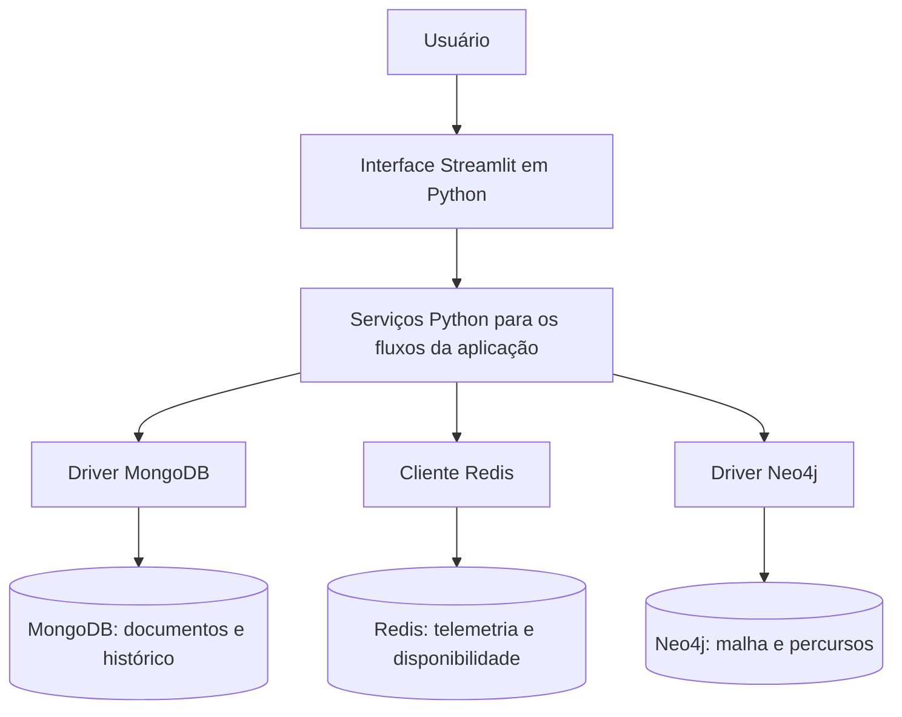

# PecinhasTransportes — planejamento do sistema logístico e rastreamento de cargas

Estudo de caso 04 — Implementação de Bancos de Dados NoSQL  
Data: 26 de outubro de 2026  
Etapa: implementação e validação local concluídas

O sistema proposto integra mercadorias, lotes, telemetria de veículos, percursos logísticos e recebimentos nas quatro telas exigidas pelo enunciado. A interface será construída em Python e Streamlit e se conectará diretamente a MongoDB, Redis e Neo4j por seus respectivos drivers/clientes.

Este planejamento distingue exigências do trabalho, decisões já confirmadas e propostas de organização. Os nomes de campos e as estruturas detalhadas em [MODELAGEM.md](MODELAGEM.md) são propostas técnicas para revisão; não são regras adicionais atribuídas ao professor.

## 1 Decisões confirmadas

| Tema | Definição do usuário |
| --- | --- |
| Escopo desta etapa | Implementação completa autorizada após planejamento e modelagem |
| Caso escolhido | Sistema Logístico e Rastreamento de Cadeia de Suprimentos |
| Tecnologias da aplicação | Python, Streamlit, MongoDB, Redis e Neo4j |
| Qualidade do código futuro | Clean code, responsabilidades claras e tratamento de erros |
| Ambiente de execução | Execução local da aplicação e dos três bancos |
| Sistema operacional | Windows 10 |
| Recursos verificados | Windows 10 Pro build 19045, aproximadamente 8 GB de RAM, Intel Core i3-1005G1 e virtualização habilitada |
| Instalação dos bancos | Docker Compose com MongoDB, Redis e Neo4j |
| Dados iniciais | Fictícios, identificados como demonstração |
| Critério de otimização | Menor distância total em quilômetros |
| Alertas de desvio e acidente | Eventos simulados por controles na interface |
| Significado de Rota | Percurso completo; os trechos são suas partes |
| Recebimento | Integral, abrangendo todos os itens e quantidades do manifesto |
| Baixa de estoque | Na confirmação do despacho, no estoque da origem |
| Disponibilidade do veículo | Volta a ficar disponível na confirmação do recebimento integral |
| Sentido dos trechos | Explícito; o retorno não é presumido |
| Documentação da carga | Objetos JSON livres |
| Telemetria | Atualização da tela a cada 5 segundos; desatualizada após 30 segundos sem nova leitura |

O ambiente local e o uso de Docker Compose foram confirmados. As versões Python diretas estão fixadas em `requirements.txt`; as imagens dos bancos e limites locais estão em `compose.yaml`. O MongoDB usa um replica set de um nó para transações entre lotes, manifesto e auditoria. O Windows foi reiniciado, os serviços foram iniciados e os testes de integração com os três bancos passaram.

## 2 Exigências do enunciado

| Área | Exigência | Evidência planejada para a entrega futura |
| --- | --- | --- |
| MongoDB | Mercadorias, lotes, especificações fiscais/técnicas, auditoria e manifestos JSON | Cadastros, consultas e histórico documental |
| Redis | GPS, velocidade, temperatura e Pub/Sub de alertas | Torre de controle com leituras e eventos simulados |
| Neo4j | Nós CentroDistribuição, PontoTransbordo, Cliente e Rota | Malha logística e percursos completos modelados |
| Consultas em grafo | `shortestPath`, menor custo e impacto de indisponibilidade | Comparação de caminhos, distância em km e bloqueios |
| Interface | Quatro telas mínimas | Fluxos descritos na seção 4 |
| Inicialização | Schemas/coleções, índices e carga nos três bancos | Scripts Python e consultas Cypher, na implementação |
| Código | Organização, comentários úteis e arquivo de dependências ou Compose | Repositório e instruções de execução futuras |
| Defesa | Explicar decisões e demonstrar os três bancos | Roteiro de demonstração após o sistema funcionar |

O documento de referência é [Projeto Final — Implementação de Bancos de Dados NoSQL](<C:/Users/lucas/Desktop/Projeto Final - Implementacao de Bancos de Dados NoSQL(1).docx>). O caso 4 é a referência funcional; os demais casos não acrescentam funcionalidades a este projeto.

## 3 Arquitetura proposta



Os serviços são módulos do mesmo aplicativo Python, sem servidor de API intermediário. As dependências diretas previstas são Streamlit e os drivers/clientes dos três bancos. A biblioteca padrão do Python atende configuração, estruturas de dados e testes; qualquer dependência adicional precisará ser discutida antes de sua inclusão.

| Responsabilidade | Organização proposta |
| --- | --- |
| Interface | Formulários, navegação, visualização e mensagens |
| Serviços | Cadastro, cálculo de percurso, simulação de alerta, despacho e recebimento |
| Repositórios | Consultas e comandos específicos de cada banco |
| Domínio | Dados, validações e regras que forem confirmadas |
| Configuração | Parâmetros de conexão separados do código |

Conexões serão reutilizadas de forma controlada. Leituras de telemetria não devem exibir dados antigos como se fossem atuais por causa de cache da interface.

## 4 Telas e fluxos

### Gestão de lotes e inventário

Consultar e cadastrar mercadorias e lotes no MongoDB. Exibir as especificações fiscais/técnicas e a documentação de carga em objetos JSON livres, conforme confirmado. A demonstração não presume campos fiscais obrigatórios ou integrações fiscais.

A proposta utiliza referências de mercadorias nos lotes e de lotes nos itens dos manifestos. O histórico de auditoria fica no MongoDB. Conforme confirmado pelo usuário, a baixa das quantidades expedidas ocorre no estoque da origem ao confirmar o despacho. Fracionamento de lotes e devoluções permanecem fora das regras definidas nesta etapa.

### Torre de controle

Exibir a última posição GPS, velocidade, temperatura e instante da leitura de cada veículo no Redis. Os dados são simulados e devem ser identificados na tela como demonstração.

Os controles de simulação produzem eventos de desvio e acidente e os publicam em canais Redis Pub/Sub. O consumidor de eventos fica no aplicativo Python. A atualização da torre ocorre a cada 5 segundos por fragmento nativo do Streamlit; leituras com mais de 30 segundos são marcadas como desatualizadas.

Simular um acidente não significa detectá-lo por velocidade ou temperatura. Não há regra de detecção automática aprovada.

### Otimizador de rotas logísticas

Selecionar origem e destino na malha Neo4j e apresentar um grafo visual de locais e trechos. Para respeitar as tecnologias definidas, a proposta é gerar a representação esquemática com Python e exibi-la no Streamlit, sem exigir biblioteca gráfica adicional.

O otimizador deverá apresentar a menor distância total e permitir comparar o caminho com menos trechos. Deve ser possível simular tanto um trecho bloqueado quanto um local inoperante. A simulação não apaga a malha; aplica exclusões temporárias à consulta.

Um nó `Rota` representa o percurso completo, de acordo com a decisão do usuário. As buscas percorrem as relações de trecho entre locais, e não as relações que descrevem os metadados de uma rota. O detalhamento está em [MODELAGEM.md](MODELAGEM.md).

### Despacho e recebimento de cargas

Relacionar a carga e o manifesto ao veículo e ao percurso escolhido. Ao confirmar o despacho, baixar as quantidades expedidas no estoque da origem e manter o veículo indisponível durante o transporte. Na confirmação do recebimento integral, registrar o histórico no MongoDB e devolver o veículo à disponibilidade no Redis.

O recebimento abrange todos os itens e quantidades do manifesto em uma confirmação integral. Essa confirmação não deve executar novamente a baixa já realizada no despacho.

A proposta preserva no manifesto uma cópia do percurso e da distância usados no despacho. Alterações futuras na malha não devem reescrever o histórico de uma entrega.

As regras de baixa e liberação do veículo estão confirmadas. Os detalhes técnicos de reserva do veículo, validação de saldo e recuperação de falhas serão definidos na implementação para cumprir esse fluxo sem efeitos duplicados.

## 5 Clean code aplicado ao projeto futuro

- Manter os nomes de domínio consistentes, em português, com convenções Python nos identificadores.
- Separar a tela das consultas de banco e das regras dos serviços.
- Preferir funções pequenas, tipos explícitos e parâmetros com significado claro.
- Usar consultas parametrizadas; concentrar Cypher nos repositórios do Neo4j.
- Registrar erros com contexto suficiente, sem expor senhas nas mensagens.
- Comentar decisões e restrições relevantes; evitar comentários que apenas repitam o código.
- Criar abstrações somente quando houver uma responsabilidade concreta.
- Tratar repetição de ações e atualizações parciais entre bancos.

Estrutura implementada:

```text
app.py
src/
  configuracao.py
  dominio.py
  bootstrap.py
  dados_demo.py
  repositorios/
  servicos/
  interface/
scripts/
  inicializar.py
  configurar.ps1
  iniciar.ps1
  continuar_apos_reinicio.ps1
tests/
requirements.txt
README.md
```

## 6 Sequência de implementação futura

| Etapa | Resultado esperado | Condição para avançar |
| --- | --- | --- |
| 1 | Revisão deste planejamento e da modelagem | Resolver regras pendentes que afetem o fluxo |
| 2 | Definição do ambiente local no Windows 10 | Confirmar recursos, modo de instalação e compatibilidade das versões |
| 3 | Conexões, validações, índices e dados de demonstração | Verificar acesso real aos três bancos |
| 4 | Cadastros e consultas de mercadorias/lotes | Confirmar persistência no MongoDB |
| 5 | Telemetria e alertas simulados | Confirmar leitura Redis e recebimento Pub/Sub |
| 6 | Grafo, menor distância e bloqueios | Confirmar os cenários numéricos da modelagem |
| 7 | Despacho, recebimento e recuperação de falhas | Validar as regras confirmadas e repetições de ação |
| 8 | Documentação e demonstração integrada | Executar o fluxo completo e preparar a defesa |

Não há estimativas de prazo, distribuição por integrante ou versões fixadas nesta etapa, pois essas informações não foram fornecidas.

## 7 Critérios de verificação futura

1. Cadastrar uma mercadoria e um lote e consultá-los no MongoDB.
2. Exibir uma leitura simulada com GPS, velocidade, temperatura e horário no Redis.
3. Publicar e receber eventos simulados de desvio e acidente com a torre de controle conectada.
4. Mostrar um percurso com mais trechos, mas menos quilômetros, e explicar a diferença entre os critérios.
5. Bloquear um trecho ou local e recalcular; informar ausência de caminho quando cabível.
6. Confirmar o despacho, conferir a baixa das quantidades no estoque da origem e a indisponibilidade do veículo durante o transporte.
7. Confirmar o recebimento integral, consultar o histórico no MongoDB e verificar que o veículo voltou à disponibilidade no Redis.
8. Repetir confirmações sem duplicar a baixa nem o recebimento e apresentar falhas parciais com clareza.

Os testes relevantes cobrirão cálculos, bloqueios, referências inválidas e repetição de ações. Os testes de integração precisarão dos bancos reais; esta etapa não afirma que foram executados.

## 8 Execução local

Por decisão do usuário, a aplicação Python/Streamlit e os três bancos serão executados localmente em uma máquina com Windows 10.

Docker Desktop, WSL 2 e o ambiente Python foram preparados e estão operacionais. Os scripts de início, carga, verificação e testes estão descritos em [README.md](README.md).

A verificação de compatibilidade e consumo ocorrerá quando o ambiente de implementação for definido. A modelagem mantém as mesmas responsabilidades de MongoDB, Redis e Neo4j.

## 9 Validação do ambiente

| Verificação | Resultado necessário |
| --- | --- |
| Ativação de WSL 2 e virtualização | Concluída após reinicialização; mecanismo Docker em execução |
| Inicialização dos três bancos | MongoDB, Redis e Neo4j saudáveis, com conexões reais disponíveis |
| Integração dos fluxos | scripts/testar.ps1 -Integracao: 50 testes executados, sem falhas ou testes ignorados |
| Consumo no computador local | Instantâneo registrado em docs/VALIDACAO.md; sem teste de carga |

Os testes unitários e de interface foram complementados pelos testes reais dos três bancos. Os resultados estão em [docs/VALIDACAO.md](docs/VALIDACAO.md).
